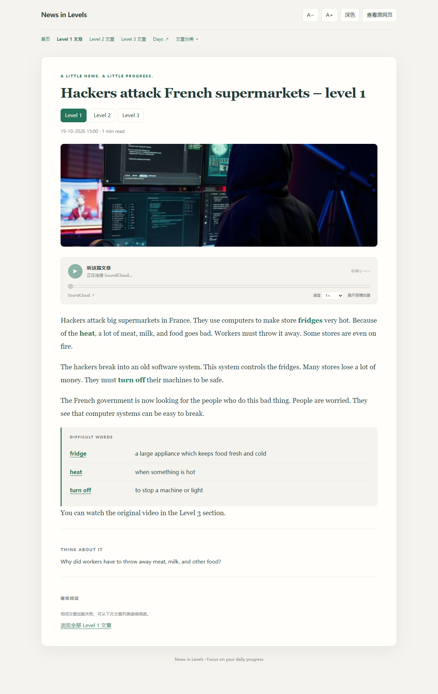
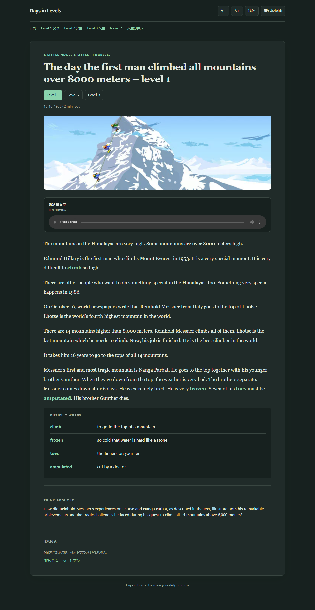

# News in Levels · 专注阅读

为 **News in Levels** 和 **Days in Levels** 打造清爽、连贯的英语阅读体验。去除广告、侧栏和推广干扰，保留文章、分级阅读和听力练习。

Chrome Manifest V3 扩展，纯原生 JavaScript，**无需构建，解压即可加载**。

## 桌面预览

### 文章阅读

统一的阅读排版，正文上方提供音频播放条，难词按词条分行展示。



### 文章列表

卡片展示文章图片、日期、摘要和等级入口，保留分类与分页导航。


### Days in Levels

历史文章沿用同一套界面，支持深色主题、原生音频和独立的历史分类。



> 预览使用真实文章图片与页面 HTML 样本生成，音频不自动播放。

## 主要功能

| 功能 | 说明 |
| --- | --- |
| 专注阅读 | 隐藏原站导航、广告、侧栏、推广和评论，保留必要的阅读入口 |
| 两站统一 | 支持 News／Days 首页、等级列表、分类列表、分页和文章详情，顶部可互相跳转 |
| 阅读设置 | 浅色／深色主题、16–30px 字号，本地保存偏好 |
| 分级学习 | 保留 Level 1／2／3 切换、文章图片、日期、正文及文末思考题 |
| 难词列表 | 词语与释义分列，每个词条独立一行，保留原有查询链接 |
| 分类浮层 | 展开时不推挤正文，点击外部、按 Esc 或滚动页面即可关闭 |
| 连续阅读 | 同等级上一篇／下一篇，以及全部文章列表入口 |
| 简洁音频 | 播放／暂停、进度、时长、连接与缓冲提示，失败后可重试 |
| SoundCloud 倍速 | 0.75×、1×、1.25×、1.5×、2×，保存速度偏好并保留音调 |
| 划词兼容 | 正文保留在普通 DOM 中，方便第三方翻译插件读取选区 |
| 原页切换 | 随时「查看原网页」，也可「返回专注阅读」 |

页面加载时提前隐藏原站界面，减少等级切换时的闪烁；未识别到受支持内容或初始化超时，会自动恢复原页。另支持窄屏布局与打印。

## 安装

1. 下载并解压 [扩展安装包](news-in-levels-reader.zip)，或直接使用本项目的 `extension` 文件夹。
2. 在 Chrome 地址栏打开 `chrome://extensions/`。
3. 开启右上角的 **开发者模式**。
4. 点击 **加载已解压的扩展程序**，选择包含 `manifest.json` 的文件夹。
5. 打开或刷新 [News in Levels](https://www.newsinlevels.com/)／[Days in Levels](https://www.daysinlevels.com/)。

加载源代码时请选择 `extension` 文件夹，而不是项目根目录。

### 更新已有安装

1. 使用新版本文件替换原安装目录中的文件。
2. 在 `chrome://extensions/` 找到本扩展，点击 **重新加载**。
3. 若 Chrome 提示新增站点访问，请确认 SoundCloud 播放器的访问权限，以启用倍速功能。
4. 刷新已打开的文章或列表页面。

## 音频与兼容性

**News 的 SoundCloud 音频**使用原平台播放器，简洁控件等待播放器真正就绪后才启用。可随时展开原播放器；重新加载音频会重置播放进度。倍速通过播放器框架内的媒体元素实现，平台内部实现变化后可能需要适配。

**Days 的原生音频**显示在正文上方。音频链接可能有有效期，失效时可通过「刷新页面并重试」重新获取。

音频不会自动播放。扩展不下载音频，也不绕过平台访问限制。

划词翻译的实际兼容性取决于第三方插件的实现。联系等未适配页面保持原站样式。上一篇／下一篇最多查找同等级列表的 10 页，加载失败或未找到时仍提供文章列表入口。

## 权限与数据

- **`storage`**：在本地保存主题、字号和 SoundCloud 播放速度。
- **News／Days 站点访问**：读取当前页面内容并替换界面；查找相邻文章时读取同站等级列表。
- **`w.soundcloud.com/player/*` 框架访问**：为播放器内部音频应用所选播放速度。

没有后台服务、统计代码或远程扩展脚本。文章图片、音视频仍由原站及其第三方平台提供。广告清理仅隐藏界面元素，不拦截原网页的网络请求。

## 开发与验证

扩展运行不需要安装依赖。自动化测试需要 **Node.js、Playwright 和 Microsoft Edge**。

```powershell
node tests/listing.cjs
node tests/reader.cjs
node tests/playback-rate.cjs
```

若 Playwright 未安装在项目模块目录，可指定包路径：

```powershell
$env:PLAYWRIGHT_PATH = 'C:/path/to/node_modules/playwright'
node tests/reader.cjs
```

| 测试 | 覆盖范围 |
| --- | --- |
| `listing.cjs` | News／Days 列表、等级和分类入口、分页、主题、分类浮层、选区和模拟翻译弹窗、Days 文章及音频错误提示 |
| `reader.cjs` | 正文与难词提取、SoundCloud 加载与重试、播放事件同步、速度选择、原页切换和窄屏布局 |
| `playback-rate.cjs` | 延迟创建的音频、速度偏好、播放器重置、媒体替换、音调保持和恢复正常速度 |

测试使用真实页面 HTML 样本，并模拟第三方播放器和网络响应；不验证实际联网播放。分类与分页的部分路由复用列表样本。若原站更新页面结构或播放器实现，需要同步更新适配与测试。

桌面预览通过 `node tests/previews.cjs` 单独生成，需要联网读取原站图片。脚本会检查图片是否成功加载，再保存截图；离线功能测试不会覆盖 README 预览图。
